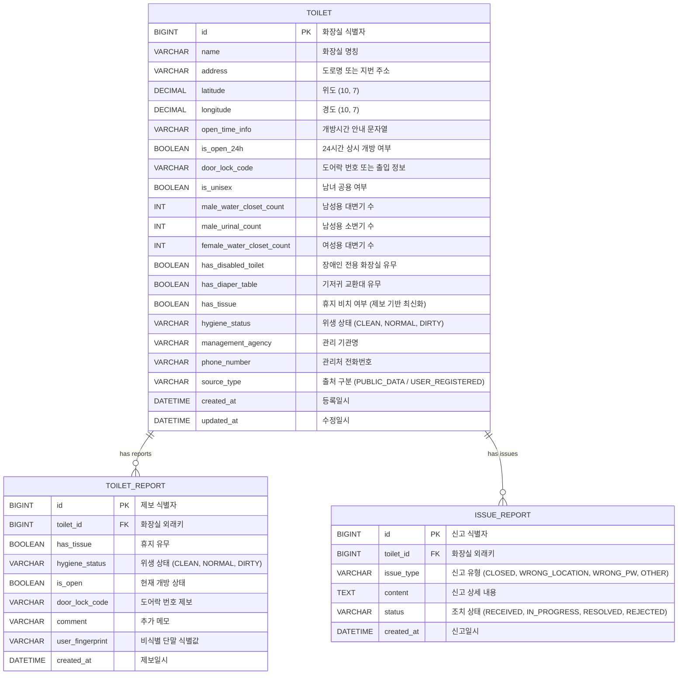

# 데이터베이스 및 시스템 설계 (ERD & Architecture)

본 문서는 **개방화장실 실시간 정보 공유 및 내비게이션 플랫폼**의 데이터베이스 모델링 및 엔티티 관계를 정의합니다.

---

## 1. ERD (Entity Relationship Diagram)



---

## 2. 테이블 상세 명세

### 1) `toilet` (개방화장실 마스터 테이블)
* **목적**: 전국의 개방 및 공중화장실의 마스터 정보를 저장합니다.
* **인덱스(Index)**:
  * `idx_toilet_location`: `(latitude, longitude)` 복합 인덱스 (위치 기반 반경 쿼리 속도 최적화)

### 2) `toilet_report` (사용자 실시간 상태 제보 테이블)
* **목적**: 사용자들이 방문하여 실시간으로 등록한 상태(휴지, 청결도 등) 히스토리를 저장합니다.
* **최신화 로직**:
  * 제보가 등록되면 `toilet` 마스터 테이블의 `has_tissue`, `hygiene_status`, `updated_at` 필드가 최신 제보를 기반으로 동기화됩니다.

### 3) `issue_report` (화장실 정보 오류 신고 테이블)
* **목적**: 폐쇄, 위치 오류, 철거 등 잘못된 공공데이터나 정보를 신고받아 처리하기 위한 테이블입니다.
* **유형(`issue_type`)**:
  * `CLOSED`: 영구 폐쇄/철거됨
  * `WRONG_LOCATION`: 지도 표시 위치가 실제와 다름
  * `WRONG_PASSWORD`: 도어락 번호가 맞지 않음
  * `OTHER`: 기타 불편 사항

---

## 3. 위치 기반 반경 검색 알고리즘 (Backend 로직)

Spring Data JPA 및 MySQL에서 사용자 위치와 반경 내의 화장실을 탐색하기 위해 **Haversine(하버사인) 공식**을 적용합니다.

```sql
SELECT *, 
       (6371 * acos(cos(radians(:userLat)) * cos(radians(latitude)) 
       * cos(radians(longitude) - radians(:userLng)) 
       + sin(radians(:userLat)) * sin(radians(latitude)))) AS distance 
FROM toilet 
WHERE latitude BETWEEN (:userLat - (:radiusKm / 111.0)) AND (:userLat + (:radiusKm / 111.0))
  AND longitude BETWEEN (:userLng - (:radiusKm / (111.0 * cos(radians(:userLat))))) AND (:userLng + (:radiusKm / (111.0 * cos(radians(:userLat)))))
HAVING distance <= :radiusKm 
ORDER BY distance ASC;
```
